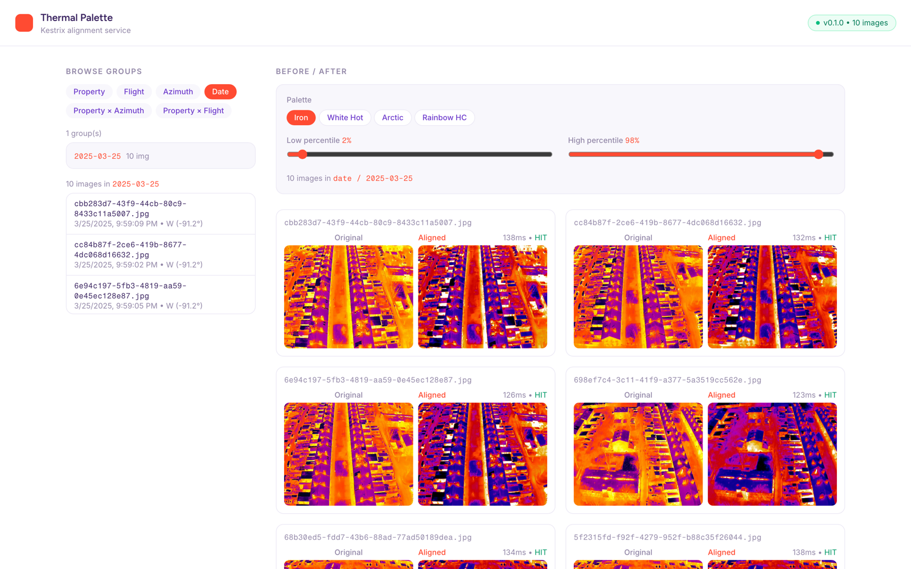
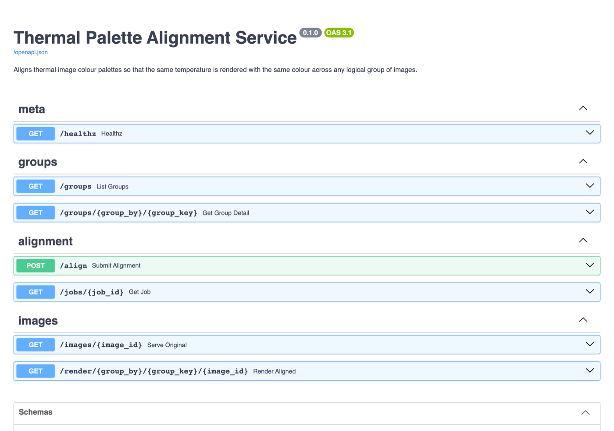

# Thermal Palette: alignment service

A FastAPI service that makes thermal images comparable. Each drone thermal image is normally
coloured using its own temperature range, so the same colour can mean different temperatures in
two photos of the same house. This service groups related images and re-renders every image in a
group against one shared temperature range, so a colour means the same temperature across the
whole group.

The front end lives in [kestrix_ui](https://github.com/RitvikJoshi97/kestrix_ui). Built as a
take-home assessment for Kestrix.



## How it works

1. **Index:** `data/image_index.csv` describes each capture (time, position, azimuth, flight,
   property). The raw temperatures for each image are stored as a NumPy array in
   `data/thermal_temps/`.
2. **Group:** images are grouped by property, flight, compass direction (azimuth), capture date,
   property and direction, or property and flight.
3. **Shared range:** for a group, the low and high percentiles (2% and 98% by default) are computed
   across all its temperature arrays, which ignores outliers. The result is cached per group and
   percentile pair.
4. **Render:** each image is mapped onto a palette (Iron, White Hot, Arctic or Rainbow HC) using the
   shared range. Changing palette never recomputes the range.

## API

Interactive docs are at `/docs` when the service is running.



| Method | Path | Purpose |
|---|---|---|
| GET | `/healthz` | Status, version and image count |
| GET | `/groups?group_by=…` | List groups for a grouping dimension |
| GET | `/groups/{group_by}/{group_key}` | Images in one group |
| GET | `/images/{image_id}` | Original image |
| GET | `/render/{group_by}/{group_key}/{image_id}` | Image re-rendered with the group's shared range (`palette`, `low`, `high` query parameters) |
| POST | `/align` | Start a background job that renders a whole group to disk |
| GET | `/jobs/{job_id}` | Poll a job |

`group_by` is one of `property`, `flight`, `azimuth`, `date`, `property_azimuth` or
`property_flight`.

## Run it

Requires Python 3.11 or later.

```bash
python -m venv .venv && source .venv/bin/activate
pip install -e ".[dev]"

thermal-palette serve --port 8000     # API on http://localhost:8000, docs at /docs
pytest                                # 71 tests
```

There is also a CLI:

```bash
thermal-palette validate                              # check every image has temperature data
thermal-palette groups --by property                  # list groups
thermal-palette align --by azimuth --key N --palette ARCTIC   # render a group to ./outputs
```

Settings such as `DATA_DIR`, `OUTPUT_DIR` and the default palette and percentiles can be set with
environment variables or a `.env` file (see `.env.example`).

## Project structure

```
src/thermal_palette/
├── api.py         # FastAPI app and routes
├── alignment.py   # index loading, shared-range rendering, background jobs
├── grouping.py    # pure grouping functions
├── palette.py     # pure palette and percentile functions
├── models.py      # Pydantic models
├── config.py      # settings
└── cli.py         # Typer CLI
tests/             # pytest suite
data/              # sample data set (10 images)
```

`Procfile` and `nixpacks.toml` deploy the service to Railway.
